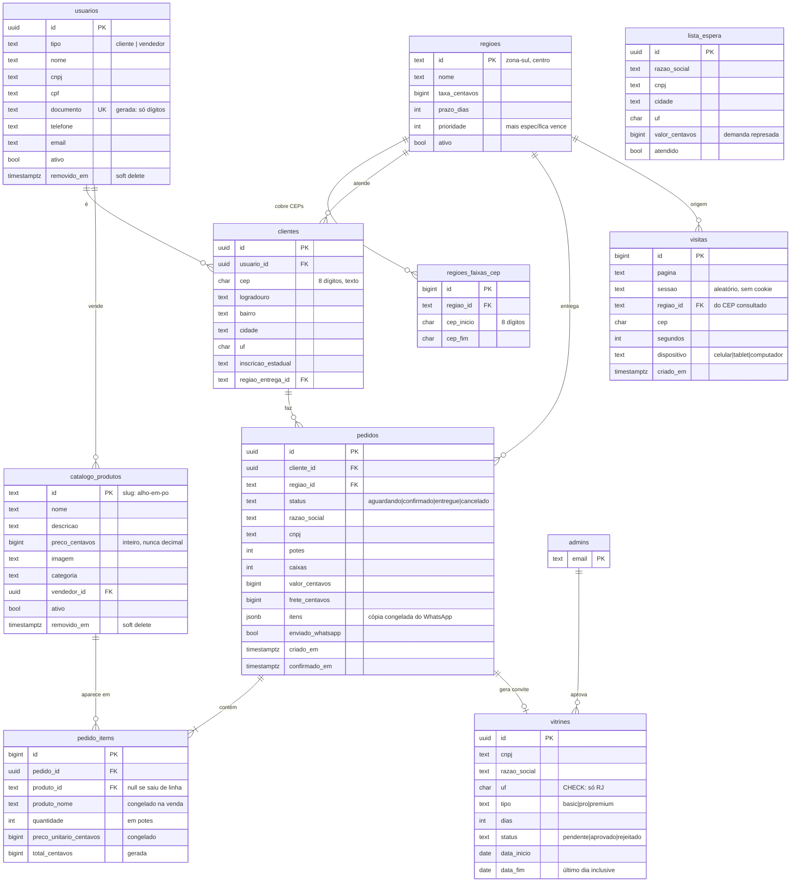

# Estrutura unificada — situação do banco e fontes

O merge não alterou o banco. B 011–016 estão aplicadas, incluindo Leads,
completar_visita, validações, RBAC e LGPD. A 012/017 também estão aplicadas,
agora arquivadas como 019/020. A 011 (agora 021, total no servidor) NÃO foi
aplicada; A 018 (agora 022, vendas diárias) NÃO foi aplicada.
Não reaplicar o SQL base nem executar a pasta de migrações inteira.

O site público usa B e inclui a adição direta do lote mínimo nos destaques.
Admin: núcleo A com SOLIDCON e vendas ERP, mais Leads/LGPD/Leaflet/RBAC de B.
eh_equipe() identifica equipe; eh_admin() exige papel admin (B 014).
O carregamento sob demanda de B evita construir mapas em abas ocultas.

| Área | Objetos do banco | Fonte/documento ativo |
|---|---|---|
| Captura | leads, visitas.pre_registro, completar_visita | B 011/012 |
| Validação | cpf_valido, cnpj_valido, telefone_valido, texto_seguro, trg_pedidos_valida | B 013/016 |
| Papéis | admins.papel, eh_equipe, eh_admin, meu_papel | B 014 |
| LGPD | consentimentos, solicitacoes_lgpd, deletados_logicamente, auditoria, RPCs LGPD | B 015 |
| Espelho | solidcon_produtos, solidcon_sync, integracoes_autorizadas | 019, já aplicada como A 012 |
| Histórico | solidcon_estoque_diario, solidcon_eventos, solidcon_config | 020, já aplicada como A 017 |
| Total/manual ERP | campos *_site_centavos, codigo_erp, RPC marcar_lancado_solidcon | 021, NÃO APLICADA |
| Vendas ERP | solidcon_vendas_dia, solidcon_vendas_sync, três views | 022, NÃO APLICADA |

A seção “Total no servidor” abaixo descreve código disponível, não comportamento
implantado. O formulário unificado continua enviando exatamente o contrato de
B, sem acrescentar os campos futuros da 021. MERGE_DECISOES.md registra escolhas
e como recuperar cada alternativa. admin/migracoes/LEIAME.md contém o mapa
completo e os cuidados de aplicação futura.

Reaplicar a 019 substitui a RPC `solidcon_receber_produtos` pela versão
anterior à 020 e interrompe a atualização do histórico e dos eventos.

## Referência de B

# Estrutura do banco

Onze tabelas, um esquema (`public`), Postgres no Supabase. Este documento é o
mapa; o que cria cada coisa está em [`admin/migracoes/LEIAME.md`](migracoes/LEIAME.md).

## Diagrama

## De onde veio cada tabela

A especificação pedia oito tabelas. Sete já existiam ou tinham equivalente — o
que foi feito foi ligar, não recriar.

| Pedido na especificação | No banco | Situação |
|---|---|---|
| `usuarios` | `usuarios` | criada na 004 |
| `clientes` | `clientes` | criada na 004 |
| `catalogo_produtos` | `catalogo_produtos` | criada na 005, semeada com os 73 |
| `pedidos` | `pedidos` | **já existia**; ganhou `cliente_id`, `regiao_id`, `enviado_whatsapp` |
| `pedido_items` | `pedido_items` | criada na 006 |
| `regioes_entrega` | `regioes` + `regioes_faixas_cep` | **já existia** |
| `displays` | `vitrines` | **já existia** |
| `visitas_site` | `visitas` | **já existia**; ganhou região, dispositivo e duração |

Duas tabelas que a especificação não listava e que já sustentam o sistema:
`admins` (quem pode entrar no painel) e `lista_espera` (quem ficou de fora da
área de entrega).

## Cinco decisões que valem saber

**Dinheiro é `bigint` de centavos, nunca decimal.** Todo o sistema já é assim.
Ponto flutuante em dinheiro acumula erro: some um centavo por linha e o total
do pedido para de bater com a soma dos itens.

**CEP é `char(8)` de texto, nunca número.** Como número, `20000-000` perde o
zero da frente — e metade do Rio começa com 2.

**A chave do cliente é o CNPJ, porque já era.** O painel e a função
`historico_do_cliente()` já agrupam por CNPJ ignorando pontuação. A coluna
gerada `documento` normaliza para dígitos puros e carrega a unicidade.

**`historico_pedidos` não é uma coluna json.** Seria uma segunda cópia da
tabela de pedidos dentro da linha do cliente, e no dia em que um pedido mudasse
de status as duas discordariam. É a relação `clientes 1:N pedidos`, resumida na
view `clientes_historico`.

**`pedidos.itens` (jsonb) e `pedido_items` não são a mesma informação duas
vezes.** O jsonb é a cópia congelada do que foi para o WhatsApp — prova, nunca
editada, nunca somada. `pedido_items` é a verdade consultável: todo relatório
por produto sai dela. Se divergirem, `pedido_items` está certa, porque é
derivada da outra.

## Operações

| O quê | Como | Quem pode |
|---|---|---|
| Criar pedido | `INSERT` em `pedidos` (como hoje) ou `criar_pedido(jsonb)` | qualquer visitante |
| Marcar enviado no WhatsApp | `marcar_enviado_whatsapp(id)` | qualquer visitante (só liga, nunca desliga) |
| Mudar status do pedido | `atualizar_status_pedido(id, status, obs)` | admin |
| Criar/editar produto | `salvar_produto(...)` | admin |
| Remover produto | `remover_produto(id)` — soft delete | admin |
| Restaurar produto | `restaurar_produto(id)` | admin |
| Aprovar vitrine | `decidir_vitrine(id, aprovar, obs)` | admin |
| Vendas por produto | `vendas_por_produto(meses)` | admin |
| Visitas por região | `visitas_por_regiao(meses)` | admin |
| Faturamento mensal | `resumo_mensal(meses)` | admin |

## Índices

Os que a especificação pediu, mais os que as chaves estrangeiras exigem para o
`join` não varrer a tabela inteira.

| Tabela | Índice | Para quê |
|---|---|---|
| `pedidos` | `criado_em desc` | listar e filtrar por data |
| `pedidos` | `cliente_id` | histórico de um cliente |
| `pedidos` | `status`, `confirmado_em desc` | fila e faturamento |
| `pedidos` | `regiao_id` | relatório por região |
| `catalogo_produtos` | `vendedor_id` | produtos de um vendedor |
| `catalogo_produtos` | `nome` (parcial: só ativos) | catálogo |
| `pedido_items` | `pedido_id`, `produto_id` | montar o pedido, vendas por produto |
| `clientes` | `cep` | busca por CEP |
| `clientes` | `usuario_id`, `regiao_entrega_id` | joins |
| `visitas` | `criado_em desc` | relatório mensal |
| `visitas` | `regiao_id`, `dispositivo`, `sessao` | relatório por região e por aparelho |
| `usuarios` | `documento` (único, só entre os vivos) | achar cliente pelo CNPJ |
| `regioes_faixas_cep` | `(cep_inicio, cep_fim)` | resolver o CEP em região |

## Segurança

A chave que o site usa (`anon`) é pública: vai no código da página e qualquer
visitante consegue lê-la. Quem protege os dados é o Row Level Security.

| Tabela | Visitante anônimo | Admin |
|---|---|---|
| `pedidos` | só inserir | ler e atualizar |
| `visitas` | inserir e completar a própria (6h) | ler |
| `lista_espera` | só inserir | ler e atualizar |
| `vitrines` | só inserir (pendente, RJ) | tudo |
| `usuarios`, `clientes`, `pedido_items` | **nada** | tudo |
| `catalogo_produtos` | ler só os ativos | tudo |
| `regioes`, `regioes_faixas_cep` | ler | escrever |

As tabelas de cadastro não têm política nenhuma para visitante. Quem escreve
nelas são os gatilhos da migração 006, que rodam como `security definer` a
partir do pedido — assim o site continua só inserindo pedido, sem ganhar uma
porta nova para escrever no cadastro.

**O que continua sendo possível para quem editar a página no navegador:**
inserir um pedido falso, ou marcar como enviado um pedido que não foi. É o
preço de um site estático sem servidor — para o site poder gravar, a permissão
de gravar tem que ser pública. Um pedido falso aparece na hora na aba Pedidos e
você cancela. Se um dia virar problema, o caminho é um servidor próprio
intermediando a gravação.

**O que não é possível:** ler pedido, cliente, contato ou qualquer dado pessoal
de alguém. E, desde a 006, também não é possível alterar o cadastro de um
cliente enviando um pedido com o CNPJ dele — os gatilhos só preenchem campo
vazio, nunca sobrescrevem.

## Extensões de A

## Total no servidor e lançamento manual (021)

`pedidos_total_servidor` é BEFORE INSERT e roda depois de
`pedidos_resolver_cliente` pela ordem alfabética dos nomes. Preserva os valores
recebidos em `valor_site_centavos` e `frete_site_centavos`, recalcula `potes` e
`valor_centavos` por item usando `catalogo_produtos.preco_centavos` e cobra
`regioes.taxa_centavos` apenas da `regiao_id` resolvida e ativa. Valor é somente
mercadoria; frete continua separado. Sem CEP válido, sem região ou com região
inativa, frete é zero. Não há fallback para outra região ativa.

O helper interno `pedido_itens_precificados(jsonb)` é compartilhado com
`pedido_explodir_itens`: produto ausente ou sem id usa o preço padrão da 021 e tem FK nula;
produto existente usa o preço cadastrado mesmo inativo/removido. Potes segue a
006: regex `^[0-9]+$`, mínimo 1; inválido/ausente/fora de integer vira 1. JSON
fora do formato array produz zero itens. Linhas que excederiam potes integer ou
total bigint são ignoradas nas duas funções, preservadas no JSON para revisão.
Os gatilhos são security definer para consultar catálogo e gravar os itens;
o helper não é exposto como RPC a anon/authenticated. Não há backfill.

`codigo_erp` identifica o produto no SOLIDCON e é único quando não nulo.
O vendedor lança o pedido manualmente no comercial e usa
`marcar_lancado_solidcon(p_pedido, p_numero)` para registrar o número com trim e
`lancado_solidcon_em = now()`. NULL ou texto vazio após trim limpa número e data;
registrar novamente renova a data. A RPC retorna a linha atualizada, ou NULL
se nenhuma linha for visível/encontrada. EXECUTE é concedido a authenticated,
com security invoker e as políticas de admin existentes. INSERT sempre inicia
os dois campos nulos, inclusive se o navegador tentar enviá-los preenchidos.

Pedidos anteriores ficam intactos, com auditoria nula. A 021 não altera
`criar_pedido`, lista de espera nem JavaScript. O preço do navegador ainda é
fixo: se o catálogo for reajustado, o painel recebe o valor do servidor e a
auditoria permite comparar com o valor mostrado/enviado pelo site.

A 021 ordena por prioridade decrescente, região ativa primeiro e id em ordem
crescente (`COLLATE "C"`). O checkout ainda usa o desempate de B. Antes de
implantar a 021, confira as faixas ativas cadastradas e alinhe os dois lados.

## 019 — Espelho de produtos SOLIDCON

Espelho isolado: sem relação com catálogo, pedidos ou preço do site nesta fase.
Origem: dois GETs locais no endpoint GetProdutos, porta 5100, filial 4,
categorias `TEMPERO - CAIXA 24 UN` e `TEMPERO - CAIXA 48 UN`. Não há escrita
nem outro endpoint no ERP.

O parâmetro `estoque` é um **filtro**, não uma opção de incluir o saldo.
O coletor faz duas consultas sequenciais no mesmo endpoint/filial:
`GET /api/Produto/GetProdutos?ativo=true&estoque=true` (saldo >0), depois
`GET /api/Produto/GetProdutos?ativo=true&estoque=false` (saldo <=0).
Só envia a união completa das duas respostas. Falha de qualquer consulta
preserva o último sucesso; não existe envio parcial nem retry dentro do ciclo.

`estoque_disponivel = max(qtd_produto, 0)`: estoque negativo na origem é aceito
e contado no resumo/log local; preço negativo continua sendo erro.
`presente=true` inclui esgotados (`estoque_disponivel=0`). `presente=false`
significa ausência nas **duas** listas de ativos (não observado na coleta: desativado/removido ou transição de saldo entre as duas consultas), não
apenas falta de saldo. Na ausência, o espelho também mantém estoque zero.

Após validar a filial de **todas** as linhas, a trava de sobreposição considera
somente as categorias vendáveis CX24/CX48. Se uma caixa vendável aparecer com
saldo em uma resposta e sem saldo na outra, aborta **todo este ciclo** e tenta
novamente no próximo agendamento. Insumos sobrepostos não entram no espelho
e não bloqueiam o ciclo; `sobrepostos_todos` é apenas diagnóstico.
Não escolhe a primeira nem a segunda linha da caixa sobreposta. Gera
`resumo-rejeitado.json` com contagens diagnósticas; não gera novo payload,
não avança estado local e não chama a RPC de produtos. Em real, tenta apenas
registrar a falha. Divergências entre EANs da mesma lista também continuam
abortando; EAN nunca multiplica estoque.

| Objeto | Dados e regra |
|---|---|
| `solidcon_produtos` | PK `id_produto bigint`; `id_loja int`; `nome`, `categoria`, `emb text`; `preco_centavos bigint`; `estoque_disponivel numeric`; `eans text[]`; `presente boolean`; `dtalteracao_erp`, `visto_em`, `atualizado_em timestamptz` |
| `solidcon_sync` | PK identity `id bigint`; `iniciado_em`, `concluido_em`; `status` ok/erro/teste; `qtd_recebida`, `qtd_presente int`; `mensagem text`; `coletado_em timestamptz`, `execucao_id uuid` (nulos apenas em logs legados/erros sem snapshot) |
| `integracoes_autorizadas` | PK/FK `user_id uuid → auth.users(id)` ON DELETE CASCADE; `nome text`, `criado_em timestamptz` |
| `solidcon_receber_produtos(jsonb, timestamptz, uuid)` | Confere identidade cadastrada, valida snapshot, upsert, marca ausentes e grava sucesso em uma transação |
| `solidcon_registrar_falha(text)` | Mesma autorização; mensagem limitada a 500 caracteres; não toca no espelho |

Pré-requisito de produção: `public.eh_equipe()` identifica qualquer email em
`admins`; `public.eh_admin()` exige também `papel='admin'`. O Tech Lead confirmou
essas definições no banco implantado. A 019 verifica a existência de ambas com
`to_regprocedure` e aborta com mensagem clara se faltar alguma. Há drift:
`eh_equipe()` não está no repo e o `eh_admin()` de `admin/supabase.sql` ainda usa
a regra antiga, só por email. **Não reaplicar `admin/supabase.sql`**: sobrescreveria
a separação de papéis de produção. A 019 não cria nem redefine esses helpers.

Todas as tabelas têm RLS: equipe lê produtos/logs via `eh_equipe()`;
apenas admin lê autorizações via `eh_admin()`. Nenhum anon/authenticated escreve
diretamente, nem mesmo admin. As RPCs só permitem EXECUTE a authenticated e
exigem UUID autorizado; SECURITY DEFINER com search_path `pg_catalog` e nomes
de schema explícitos. Não usar usuário admin/service_role no script.

EANs não somam estoque: API repete produto por EAN. EAN textual conserva zeros;
se a API já enviou número, zeros anteriores não podem ser reconstruídos.
`qtd_produto` é disponível (quantidade menos comprometido), não saldo bruto.
Ausente da união válida das duas listas fica `presente=false` e estoque zero;
`visto_em` mantém a última presença e `atualizado_em` registra a transição.
Preço/nome anteriores são preservados no ausente. O log de sucesso conta itens
normalizados distintos. Datas sem fuso são interpretadas em São Paulo pelo
script; confirmar a convenção com TI. Nomes quebrados (U+FFFD) não são corrigidos.
Modo teste só gera arquivos locais; status `teste` no banco está reservado.

A RPC recebe `p_itens jsonb`, `p_coletado_em timestamptz` e `p_execucao_id uuid`,
sem defaults; remove a assinatura legada que aceitava só JSON. `coletado_em`
é o instante UTC após receber os dois corpos da API; UUID identifica a execução.
Dentro do advisory lock, compara o total distinto recebido da união com os
produtos persistidos `presente=true` e rejeita quantidade inferior à metade
(exatamente 50% passa). Inclui presentes esgotados, não apenas saldo positivo. Também rejeita coleta
anterior ou igual ao último `status='ok'`, UUID já aceito, data ausente/infinita,
mais antiga que 24h ou mais de 5min à frente do relógio do banco.

Essas rejeições retornam JSON `status='erro'`/`motivo`, gravam apenas o log e
preservam o espelho e o último snapshot aceito. Não usam RAISE, que desfaria
também o log. O script trata o retorno como falha/exit 1, não atualiza estado
local nem duplica o log remoto. Erros de payload/permissão continuam gerando
exceção e rollback; quando possível, o script registra falha separadamente.
O último horário aceito é `max(coletado_em)` nos logs `ok`: preservar esse
histórico ao fazer manutenção. Logs legados ficam com metadados nulos, sem
inventar coleta anterior; o primeiro snapshot novo estabelece a referência.

O script também mantém a trava local de queda. O mutex nomeado
`Global\TempRioSolidconSync` bloqueia concorrência na mesma máquina mesmo
com pastas de saída diferentes; o lock de arquivo permanece como segunda trava.
Operação suportada: um único coletor no servidor interno; não executar em
outra máquina. As consultas sequenciais não são um snapshot atômico do ERP.

### Auditoria estática das permissões existentes (não consulta o banco remoto)

Não foi encontrada policy que dê leitura de pedidos, clientes ou usuários a
todo authenticated: exigem `eh_admin()` (`admin/supabase.sql:116`,
`admin/migracoes/004_usuarios_clientes.sql:155`). As views de conferência e
histórico usam security_invoker (`006_pedido_items.sql:326`, `:346`). A conta
de sync deve ter email exclusivo, ausente de `admins`, sem outros grants.

**Há exceções públicas**, que já incluem anon e authenticated; portanto a conta
dedicada também consegue as operações que qualquer visitante consegue:

- INSERT em pedidos, visitas e espera (`admin/supabase.sql:109`, `:166`, `:215`);
- solicitar vitrine pendente/RJ (`admin/supabase-vitrine.sql:80`);
- UPDATE de visitas com menos de 6h (`admin/migracoes/007_visitas_regiao.sql:132`);
- SELECT de regiões/faixas (`admin/supabase-regioes.sql:71`, `:77`) e produtos
  ativos (`admin/migracoes/005_catalogo_produtos.sql:91`);
- view pública de vitrines e RPC `historico_do_cliente` (agregados por CNPJ,
  incluindo valor total: `admin/supabase-vitrine.sql:133`, `:147`);
- RPCs públicas `criar_pedido` e `marcar_enviado_whatsapp`
  (`admin/migracoes/008_crud.sql:25`, `:81`).

A 019 não amplia essas permissões nem modifica as existentes. Isolar a conta
também dessas operações públicas exigiria revisão específica das policies E
RPCs existentes, fora desta entrega. A verificação final do estado implantado
via `pg_policies`/grants está pendente: nenhum SQL foi executado no Supabase.

Para desfazer: parar a tarefa, remover as duas RPCs e as três tabelas em
transação, sem CASCADE, conforme SQL de `admin/migracoes/LEIAME.md`, seção 019.
Perde o espelho/log/autorizações; não altera catálogo, pedidos ou objetos da 021.

## 020 — Histórico diário, eventos e limite SOLIDCON

Extensão isolada da 019 já instalada; não altera o coletor, o catálogo ou
pedidos. Os números 013–016 são reservados às migrações do outro repo já
implantadas. Os nomes novos são específicos de SOLIDCON, sem objetos genéricos.

| Objeto | Campos e finalidade |
|---|---|
| `solidcon_estoque_diario` | PK `(dia date,id_produto bigint)`; `estoque_disponivel numeric`, `preco_centavos bigint`, `presente boolean`, `atualizado_em timestamptz` |
| `solidcon_eventos` | `id bigint identity` PK; `em timestamptz`, `id_produto bigint`, `nome text`, `tipo text` com CHECK de sete tipos; `valor_antes numeric`, `valor_depois numeric`, `coletado_em timestamptz` |
| `solidcon_config` | linha única `id smallint=1`; `limite_estoque_baixo integer NOT NULL DEFAULT 5 CHECK >=0`; `atualizado_em timestamptz` |
| `solidcon_definir_limite(integer)` | Admin altera o limite, retorna o valor salvo; valida nulo/negativo, serializa com a coleta |

Não há FK de histórico/eventos para o espelho: os registros conservam o ID e
o nome observado mesmo se uma manutenção posterior remover o produto. Índices
dos eventos: `solidcon_eventos_em_idx` e `solidcon_eventos_produto_em_idx`.
A PK do diário serve para upsert e retenção por dia.

A RPC de recebimento mantém assinatura, contrato JSON e todas as travas da 019.
Somente após a aceitação, ainda sob o mesmo advisory lock, lê o limite e compara
o payload com o espelho anterior. Depois grava eventos, aplica o upsert/ausência
da 019 e registra a foto final do espelho inteiro, inclusive ausentes. Um erro
nesses acréscimos reverte todo o snapshot. Rejeições de negócio só gravam o
log de erro da 019, sem tocar em eventos, diário, config ou espelho.

| Evento | Regra | Valores antes → depois |
|---|---|---|
| `produto_novo` | ID ainda não existe fisicamente em `solidcon_produtos` | NULL → estoque |
| `esgotou` | Estava presente com estoque >0 e foi recebido com zero | estoque → 0 |
| `voltou_estoque` | Estava presente com zero e foi recebido com >0 | 0 → estoque |
| `estoque_baixo` | Estava presente com estoque >limite; recebido com `0 < estoque <= limite` | estoque → estoque |
| `preco_mudou` | ID existente recebido com preço diferente, inclusive ao reaparecer | centavos → centavos |
| `sumiu` | Estava presente e não veio na união aceita | 1 → 0 (presença) |
| `reapareceu` | Existia com `presente=false` e voltou ao payload | 0 → 1 (presença) |

`sumiu` significa não observado na coleta, não prova desativação no ERP.
Não gera `esgotou` artificial ao sumir nem `voltou_estoque` artificial ao
reaparecer. Produto novo e reaparecido não geram alerta baixo inicial;
o alerta exige cruzamento com baseline presente. Permanecer abaixo do limite
não repete alerta; subir e cruzar novamente gera outro. Preço pode gerar evento
junto com estoque/presença. Alterar o limite não cria eventos retroativos.
Limite zero desliga `estoque_baixo`. Os campos numéricos preservam frações de
estoque e centavos sem ponto flutuante.

`em` marca o processamento no banco, enquanto `coletado_em` identifica a
observação do ERP. Dia da foto é `(coletado_em AT TIME ZONE
'America/Sao_Paulo')::date`. Cada aceitação sobrescreve o dia com o estado mais
recente aceito, sem backfill. Primeiro snapshot após a instalação usa o espelho
já existente como baseline, podendo registrar alterações reais. Não classifica
os existentes como novos; só IDs de fato inéditos geram `produto_novo`.

Retenção diária, dentro da RPC aceita: `dia < hoje_em_Sao_Paulo - 400`.
O dia com 400 dias exatos permanece, o de 401 sai; isso mantém hoje e até
400 datas anteriores. Não depende de cron adicional, e rejeições não executam
a limpeza. Eventos não são removidos automaticamente nesta fase.

RLS/SELECT por `eh_equipe()` nas três tabelas. Nenhuma escrita direta para
anon/authenticated, nem admin. Mudança de limite é exclusivamente pela RPC
`solidcon_definir_limite`, **SECURITY DEFINER** com `eh_admin()` explícito,
`auth.uid()`, `search_path=pg_catalog` e nomes qualificados. EXECUTE somente
authenticated; acesso à sequência dos eventos revogado. A opção DEFINER evita
dar UPDATE direto ao admin, necessário se fosse INVOKER.

Pré-requisito validado antes de criar objetos: 019 completa, sua RPC de três
argumentos e helpers de produção. Não reaplicar `admin/supabase.sql` por causa
do drift de papéis. A 020 já está aplicada em produção como 017 de A.
Teste dinâmico realizado no PostgreSQL 18 local isolado, com helpers de
identidade simulados; nenhum acesso ao ERP/Supabase.

Rollback: pausar a tarefa, restaurar só a RPC da 019 e remover RPC de limite e
as três tabelas da 020 na mesma transação, sem CASCADE. O gerador PowerShell
completo está na seção 020 de `admin/migracoes/LEIAME.md`. Perde histórico,
eventos e configuração; mantém espelho/log/autorizações e o script.

## 022 — Vendas diárias, formatos e famílias SOLIDCON

Extensão independente do estoque/eventos 019/020, com preflight dessas duas
migrações e dos helpers de papéis. Não modifica suas tabelas ou RPCs.

| Objeto | Dados/uso |
|---|---|
| `solidcon_vendas_dia` | PK `(dia date,ean text)`; nome/categoria text NULL; formato pote/cx24/cx48/outro; potes_por_unidade integer NULL; familia text NULL; qtd numeric; valor_centavos, valor_bruto_centavos, desconto_centavos bigint; coletado_em timestamptz |
| `solidcon_vendas_sync` | id bigint identity; dia, status ok/erro, linhas, valor_total_centavos bigint, coletado_em, execucao_id uuid, mensagem text, em timestamptz |
| `solidcon_receber_vendas(date,jsonb,timestamptz,uuid)` | Autorização da integração, validação, ordem e substituição atômica de um dia |
| `solidcon_vendas_por_dia` | dia, soma do líquido em centavos, potes equivalentes conhecidos |
| `solidcon_vendas_por_mes` | mes (primeiro dia), líquido, potes, dias distintos com qtd>0 ou líquido>0 |
| `solidcon_vendas_familia_mes` | mes, família, nome_familia, formato, qtd, líquido e potes |

RLS nas duas tabelas: SELECT somente eh_equipe; nenhuma escrita direta para
anon/authenticated, nem admin. Views security_invoker, SELECT authenticated;
quem não é equipe lê zero linhas. RPC SECURITY DEFINER, pg_catalog, schemas
explícitos, EXECUTE authenticated e whitelist integracoes_autorizadas.
Lock próprio `(5100,18)`; não disputa o lock de estoque `(5100,4)`.

O dia aceita hoje-400..hoje, referência America/Sao_Paulo. Máximo 2000 itens/
4 MiB, valores não negativos, EANs textuais únicos. Coleta deve estar nas últimas
24h e no máximo 5min à frente; nunca confundir data da coleta com dia da venda.
Sob lock, verifica o último sucesso **por dia** e UUID aceito global. Depois
DELETE+INSERT substitui todas as linhas daquele dia. Um erro reverte tudo.
`[]` é permitido para dia sem linhas e rejeitado se o dia já tinha vendas,
mesmo se o vazio for legítimo; não há override nesta fase.
Rejeição só grava log erro com motivo controlado e retorna status erro; não
atualiza a referência aceita nem os dados. Falha antes da RPC fica no log local.
Não há retenção automática das vendas/logs nesta entrega.

Enriquecimento usa as duas respostas GetProdutos do ciclo, inclusive categorias
que não entram no espelho de caixas. Busca por codigo_ean, depois id_produto,
ou cdProduto no retorno bruto. EAN/código interno retornado pela venda continua
como texto original; zeros textuais são preservados. Aliases não somam estoque
e metadados conflitantes não são resolvidos pela última linha: ficam sem mapa.

| Categoria ERP | Formato | Potes por unidade |
|---|---|---|
| TEMPERO - MATÉRIA PRIMA EM PROCESSO | pote | 1 |
| TEMPERO - CAIXA 24 UN | cx24 | 24 |
| TEMPERO - CAIXA 48 UN | cx48 | 48 |
| Outras ou sem correspondência | outro | NULL |

A variante MATÉRIA com U+FFFD já quebrada na API também é reconhecida, sem
reescrever nome/categoria. Família: EAN13 de pote perde o último dígito;
GTIN14 de caixa usa os 12 dígitos das posições 2..13. Ao resolver código interno,
pode usar a família de um EAN do catálogo se inequívoca. Fora desses casos,
família fica NULL. Não inferir embalagem desconhecida só pelo tamanho do EAN.
Valores entram nas somas mesmo quando formato é outro; potes desses itens
não são estimados (contribuem zero no agregado de potes conhecidos).

Nome da família prioriza o nome mais recente de um pote vendido daquela família
quando houver nos dados; senão usa nome de item. Sem família, a view agrupa por
`ean:identificador` para não fundir todos os desconhecidos no mesmo grupo;
sem nome, usa essa chave. SUM de dinheiro/quantidades é numeric, sem ponto
flutuante. Dias vazios não criam linha nas views: o painel deve preencher lacunas.

Hoje/ontem são coletados após estoque, sucesso ou falha. Falha na leitura do
catálogo não cancela vendas: nome/categoria/fator/família NULL, formato outro.
Um sucesso posterior reclassifica o dia ao substituir seus dados. Isso pode
deixar o agregado de potes temporariamente incompleto, preservando receita.
Cada dia tem UUID e coletado_em próprios; falhas de vendas não alteram estoque.
Código 3 identifica só vendas falhando com estoque OK; 1 prevalece se estoque
falhar; 0 só quando os fluxos executados terminam OK.

Backfill manual N=1..400 não envia estoque: lê catálogo para enriquecer e
consulta/envia N datas, incluindo hoje, com pausa 700ms entre GETs de dias.
Modo teste nunca chama Supabase; ArquivoVendas aceita o array bruto ou o array
histórico dia/ean/qtd/valor/valor_bruto/desconto. Com arquivos, vazios inferidos
são apenas um recurso de teste; modo real recusa todos os arquivos de entrada.

QA com amostra real de 180 dias: totais conferidos linha a linha contra a origem
(valores comerciais ficam fora do repositório, que é público). Alguns
identificadores ficaram sem catálogo nas amostras; a receita é preservada.
Testado no PostgreSQL 18 local isolado, inclusive carga completa e views,
RLS/ordem/vazio/substituição/rollback, sem acessar produção.

Rollback e ordem de implantação futura: seção 022 de admin/migracoes/LEIAME.md.
Remover views, RPC e as duas tabelas (sem CASCADE) perde só vendas/logs; restaurar
o script pré-022. Objetos 019/020 e dados de estoque/eventos permanecem intactos.

## 036 — LGPD sem self-service, EXECUTE de anon e search_path

- `lgpd_meus_dados(documento, telefone)` não devolve mais dado pessoal: grava `solicitacoes_lgpd` com `tipo='acesso'` (o CHECK agora aceita `acesso`, `exclusao` e `correcao`) e uma linha em `auditoria`, e devolve sempre `{status:'recebido', protocolo, prazo_dias:15}`. A equipe responde em até 15 dias.
- Funções SECURITY DEFINER que `anon` executa (lista fechada): `criar_pedido`, `marcar_enviado_whatsapp`, `completar_visita`, `lgpd_meus_dados`, `historico_do_cliente`, `solidcon_catalogo_publico` e `solidcon_ficha_publica`. Todas as outras perderam EXECUTE de `anon`/PUBLIC; `authenticated`/`service_role` ficaram como estavam. Os gatilhos não dependem desse EXECUTE.
- Função nova em `public`: sempre `revoke all on function ... from public, anon` e depois `grant` explícito (o PUBLIC é padrão global do Postgres).
- DEFINER com `search_path = pg_catalog, pg_temp` (019–035) e `public, pg_temp` (004–016, 028); tabelas sempre qualificadas como `public.x`.

## 037 — Qualidade do endereço, "Corrigir no ERP" e interessados

- `solidcon_037_avaliacao()`: qualidade (`confiavel` / `aproximado` / `sem_localizacao`) + motivos por cliente CNPJ, calculada na leitura (nada gravado).
- `solidcon_mapa_clientes()` ganhou `qualidade` e `motivos` no fim.
- `solidcon_geo_corrigir_erp()`: clientes sem localização confiável ou com cadastro a corrigir no ERP.
- `solidcon_interessados()`: lista de espera e pedidos do site cujo CNPJ não comprou no ERP. Documento mascarado, sem contato; posição aproximada pela média dos clientes já localizados (CEP, depois bairro, depois cidade).
- Todas INVOKER, só equipe, sem EXECUTE para anon. A validação "o ponto está no município" é feita no navegador ao geocodificar (busca limitada à caixa do município e com a cidade conferida).

## 038 — RLS mais rápido, sem FOR ALL e anon só INSERT

- Políticas chamam `(select public.eh_admin())` / `(select public.eh_equipe())`, calculadas uma vez por consulta.
- Sem `FOR ALL`: admin tem `insere/atualiza/apaga` explícitos em `catalogo_produtos`, `pedido_items`, `regioes`, `regioes_faixas_cep`, e `insere/apaga` em `usuarios`/`clientes` (ler e atualizar vêm das políticas de equipe).
- `pedidos.cnpj_digitos` (gerada, indexada), usada por `historico_do_cliente`.
- anon só tem INSERT em `pedidos`, `leads`, `visitas`, `lista_espera`, `solicitacoes_lgpd`, `consentimentos` e `vitrines`; o site insere sempre com `return=minimal`.
- `public.vitrines` agora tem definição de referência em `admin/migracoes/base/vitrines.sql` (export de produção).
