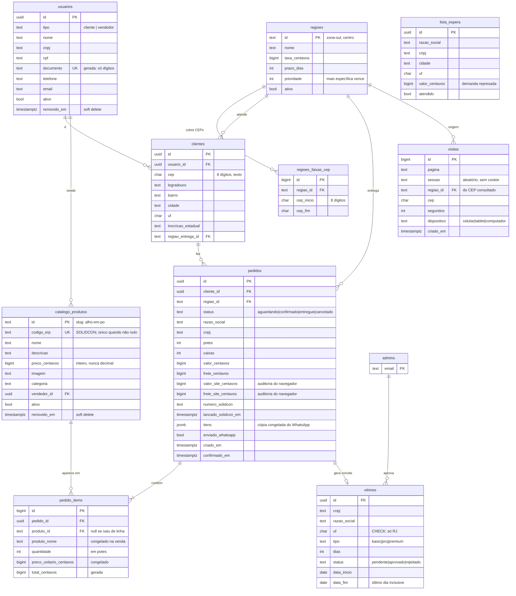

# Estrutura do banco

Onze tabelas, um esquema (`public`), Postgres no Supabase. Este documento é o
mapa; o que cria cada coisa está em [`admin/migracoes/LEIAME.md`](migracoes/LEIAME.md).

## Diagrama

## De onde veio cada tabela

A especificação pedia oito tabelas. Sete já existiam ou tinham equivalente — o
que foi feito foi ligar, não recriar.

| Pedido na especificação | No banco | Situação |
|---|---|---|
| `usuarios` | `usuarios` | criada na 004 |
| `clientes` | `clientes` | criada na 004 |
| `catalogo_produtos` | `catalogo_produtos` | criada na 005, semeada com os 73 |
| `pedidos` | `pedidos` | **já existia**; ganhou `cliente_id`, `regiao_id`, `enviado_whatsapp` |
| `pedido_items` | `pedido_items` | criada na 006 |
| `regioes_entrega` | `regioes` + `regioes_faixas_cep` | **já existia** |
| `displays` | `vitrines` | **já existia** |
| `visitas_site` | `visitas` | **já existia**; ganhou região, dispositivo e duração |

Duas tabelas que a especificação não listava e que já sustentam o sistema:
`admins` (quem pode entrar no painel) e `lista_espera` (quem ficou de fora da
área de entrega).

## Cinco decisões que valem saber

**Dinheiro é `bigint` de centavos, nunca decimal.** Todo o sistema já é assim.
Ponto flutuante em dinheiro acumula erro: some um centavo por linha e o total
do pedido para de bater com a soma dos itens.

**CEP é `char(8)` de texto, nunca número.** Como número, `20000-000` perde o
zero da frente — e metade do Rio começa com 2.

**A chave do cliente é o CNPJ, porque já era.** O painel e a função
`historico_do_cliente()` já agrupam por CNPJ ignorando pontuação. A coluna
gerada `documento` normaliza para dígitos puros e carrega a unicidade.

**`historico_pedidos` não é uma coluna json.** Seria uma segunda cópia da
tabela de pedidos dentro da linha do cliente, e no dia em que um pedido mudasse
de status as duas discordariam. É a relação `clientes 1:N pedidos`, resumida na
view `clientes_historico`.

**`pedidos.itens` (jsonb) e `pedido_items` não são a mesma informação duas
vezes.** O jsonb é a cópia congelada do que foi para o WhatsApp — prova, nunca
editada; desde a 011, seus itens alimentam o recálculo no servidor. `pedido_items` é a verdade consultável: todo relatório
por produto sai dela. Se divergirem, `pedido_items` está certa, porque é
derivada da outra.

## Operações

| O quê | Como | Quem pode |
|---|---|---|
| Criar pedido | `INSERT` em `pedidos` (como hoje) ou `criar_pedido(jsonb)` | qualquer visitante |
| Marcar enviado no WhatsApp | `marcar_enviado_whatsapp(id)` | qualquer visitante (só liga, nunca desliga) |
| Registrar/desfazer lançamento SOLIDCON | `marcar_lancado_solidcon(p_pedido uuid, p_numero text)` — retorna a linha atualizada ou NULL se inexistente/invisível | admin autenticado (security invoker/RLS) |
| Mudar status do pedido | `atualizar_status_pedido(id, status, obs)` | admin |
| Criar/editar produto | `salvar_produto(...)` | admin |
| Remover produto | `remover_produto(id)` — soft delete | admin |
| Restaurar produto | `restaurar_produto(id)` | admin |
| Aprovar vitrine | `decidir_vitrine(id, aprovar, obs)` | admin |
| Vendas por produto | `vendas_por_produto(meses)` | admin |
| Visitas por região | `visitas_por_regiao(meses)` | admin |
| Faturamento mensal | `resumo_mensal(meses)` | admin |

## Índices

Os que a especificação pediu, mais os que as chaves estrangeiras exigem para o
`join` não varrer a tabela inteira.

| Tabela | Índice | Para quê |
|---|---|---|
| `pedidos` | `criado_em desc` | listar e filtrar por data |
| `pedidos` | `cliente_id` | histórico de um cliente |
| `pedidos` | `status`, `confirmado_em desc` | fila e faturamento |
| `pedidos` | `regiao_id` | relatório por região |
| `catalogo_produtos` | `codigo_erp` (único parcial: não nulo) | identificar produto no comercial SOLIDCON |
| `catalogo_produtos` | `vendedor_id` | produtos de um vendedor |
| `catalogo_produtos` | `nome` (parcial: só ativos) | catálogo |
| `pedido_items` | `pedido_id`, `produto_id` | montar o pedido, vendas por produto |
| `clientes` | `cep` | busca por CEP |
| `clientes` | `usuario_id`, `regiao_entrega_id` | joins |
| `visitas` | `criado_em desc` | relatório mensal |
| `visitas` | `regiao_id`, `dispositivo`, `sessao` | relatório por região e por aparelho |
| `usuarios` | `documento` (único, só entre os vivos) | achar cliente pelo CNPJ |
| `regioes_faixas_cep` | `(cep_inicio, cep_fim)` | resolver o CEP em região |

## Segurança

A chave que o site usa (`anon`) é pública: vai no código da página e qualquer
visitante consegue lê-la. Quem protege os dados é o Row Level Security.

| Tabela | Visitante anônimo | Admin |
|---|---|---|
| `pedidos` | só inserir | ler e atualizar |
| `visitas` | inserir e completar a própria (6h) | ler |
| `lista_espera` | só inserir | ler e atualizar |
| `vitrines` | só inserir (pendente, RJ) | tudo |
| `usuarios`, `clientes`, `pedido_items` | **nada** | tudo |
| `catalogo_produtos` | ler só os ativos | tudo |
| `regioes`, `regioes_faixas_cep` | ler | escrever |

As tabelas de cadastro não têm política nenhuma para visitante. Quem escreve
nelas são os gatilhos da migração 006, que rodam como `security definer` a
partir do pedido — assim o site continua só inserindo pedido, sem ganhar uma
porta nova para escrever no cadastro.

**O que continua sendo possível para quem editar a página no navegador:**
inserir um pedido falso, ou marcar como enviado um pedido que não foi. É o
preço de um site estático sem servidor — para o site poder gravar, a permissão
de gravar tem que ser pública. Um pedido falso aparece na hora na aba Pedidos e
você cancela. Se um dia virar problema, o caminho é um servidor próprio
intermediando a gravação.

**O que não é possível:** ler pedido, cliente, contato ou qualquer dado pessoal
de alguém. E, desde a 006, também não é possível alterar o cadastro de um
cliente enviando um pedido com o CNPJ dele — os gatilhos só preenchem campo
vazio, nunca sobrescrevem.

## Total no servidor e lançamento manual (011)

`pedidos_total_servidor` é BEFORE INSERT e roda depois de
`pedidos_resolver_cliente` pela ordem alfabética dos nomes. Preserva os valores
recebidos em `valor_site_centavos` e `frete_site_centavos`, recalcula `potes` e
`valor_centavos` por item usando `catalogo_produtos.preco_centavos` e cobra
`regioes.taxa_centavos` apenas da `regiao_id` resolvida e ativa. Valor é somente
mercadoria; frete continua separado. Sem CEP válido, sem região ou com região
inativa, frete é zero. Não há fallback para outra região ativa.

O helper interno `pedido_itens_precificados(jsonb)` é compartilhado com
`pedido_explodir_itens`: produto ausente/sem id custa 400 centavos e tem FK nula;
produto existente usa o preço cadastrado mesmo inativo/removido. Potes segue a
006: regex `^[0-9]+$`, mínimo 1; inválido/ausente/fora de integer vira 1. JSON
fora do formato array produz zero itens. Linhas que excederiam potes integer ou
total bigint são ignoradas nas duas funções, preservadas no JSON para revisão.
Os gatilhos são security definer para consultar catálogo e gravar os itens;
o helper não é exposto como RPC a anon/authenticated. Não há backfill.

`codigo_erp` identifica o produto no SOLIDCON e é único quando não nulo.
O vendedor lança o pedido manualmente no comercial e usa
`marcar_lancado_solidcon(p_pedido, p_numero)` para registrar o número com trim e
`lancado_solidcon_em = now()`. NULL ou texto vazio após trim limpa número e data;
registrar novamente renova a data. A RPC retorna a linha atualizada, ou NULL
se nenhuma linha for visível/encontrada. EXECUTE é concedido a authenticated,
com security invoker e as políticas de admin existentes. INSERT sempre inicia
os dois campos nulos, inclusive se o navegador tentar enviá-los preenchidos.

Pedidos anteriores ficam intactos, com auditoria nula. A 011 não altera
`criar_pedido`, lista de espera nem JavaScript. O preço do navegador ainda é
fixo: se o catálogo for reajustado, o painel recebe o valor do servidor e a
auditoria permite comparar com o valor mostrado/enviado pelo site.

O seletor de região da 011 e `js/entrega.js` usam a mesma ordem total:
prioridade decrescente, ativo primeiro e id crescente em ordem Unicode/binária
(`COLLATE "C"` no SQL). Especificidade continua definida pela prioridade;
largura da faixa de CEP não participa. Inverter a ordem dos dados não muda
a região selecionada quando prioridade e estado empatam.

## 012 — Espelho de produtos SOLIDCON

Espelho isolado: sem relação com catálogo, pedidos ou preço do site nesta fase.
Origem: dois GETs locais no endpoint GetProdutos, porta 5100, filial 4,
categorias `TEMPERO - CAIXA 24 UN` e `TEMPERO - CAIXA 48 UN`. Não há escrita
nem outro endpoint no ERP.

O parâmetro `estoque` é um **filtro**, não uma opção de incluir o saldo.
O coletor faz duas consultas sequenciais no mesmo endpoint/filial:
`GET /api/Produto/GetProdutos?ativo=true&estoque=true` (saldo >0), depois
`GET /api/Produto/GetProdutos?ativo=true&estoque=false` (saldo <=0).
Só envia a união completa das duas respostas. Falha de qualquer consulta
preserva o último sucesso; não existe envio parcial nem retry dentro do ciclo.

`estoque_disponivel = max(qtd_produto, 0)`: estoque negativo na origem é aceito
e contado no resumo/log local; preço negativo continua sendo erro.
`presente=true` inclui esgotados (`estoque_disponivel=0`). `presente=false`
significa ausência nas **duas** listas de ativos (não observado na coleta: desativado/removido ou transição de saldo entre as duas consultas), não
apenas falta de saldo. Na ausência, o espelho também mantém estoque zero.

Após validar a filial de **todas** as linhas, a trava de sobreposição considera
somente as categorias vendáveis CX24/CX48. Se uma caixa vendável aparecer com
saldo em uma resposta e sem saldo na outra, aborta **todo este ciclo** e tenta
novamente no próximo agendamento. Insumos sobrepostos não entram no espelho
e não bloqueiam o ciclo; `sobrepostos_todos` é apenas diagnóstico.
Não escolhe a primeira nem a segunda linha da caixa sobreposta. Gera
`resumo-rejeitado.json` com contagens diagnósticas; não gera novo payload,
não avança estado local e não chama a RPC de produtos. Em real, tenta apenas
registrar a falha. Divergências entre EANs da mesma lista também continuam
abortando; EAN nunca multiplica estoque.

| Objeto | Dados e regra |
|---|---|
| `solidcon_produtos` | PK `id_produto bigint`; `id_loja int`; `nome`, `categoria`, `emb text`; `preco_centavos bigint`; `estoque_disponivel numeric`; `eans text[]`; `presente boolean`; `dtalteracao_erp`, `visto_em`, `atualizado_em timestamptz` |
| `solidcon_sync` | PK identity `id bigint`; `iniciado_em`, `concluido_em`; `status` ok/erro/teste; `qtd_recebida`, `qtd_presente int`; `mensagem text`; `coletado_em timestamptz`, `execucao_id uuid` (nulos apenas em logs legados/erros sem snapshot) |
| `integracoes_autorizadas` | PK/FK `user_id uuid → auth.users(id)` ON DELETE CASCADE; `nome text`, `criado_em timestamptz` |
| `solidcon_receber_produtos(jsonb, timestamptz, uuid)` | Confere identidade cadastrada, valida snapshot, upsert, marca ausentes e grava sucesso em uma transação |
| `solidcon_registrar_falha(text)` | Mesma autorização; mensagem limitada a 500 caracteres; não toca no espelho |

Pré-requisito de produção: `public.eh_equipe()` identifica qualquer email em
`admins`; `public.eh_admin()` exige também `papel='admin'`. O Tech Lead confirmou
essas definições no banco implantado. A 012 verifica a existência de ambas com
`to_regprocedure` e aborta com mensagem clara se faltar alguma. Há drift:
`eh_equipe()` não está no repo e o `eh_admin()` de `admin/supabase.sql` ainda usa
a regra antiga, só por email. **Não reaplicar `admin/supabase.sql`**: sobrescreveria
a separação de papéis de produção. A 012 não cria nem redefine esses helpers.

Todas as tabelas têm RLS: equipe lê produtos/logs via `eh_equipe()`;
apenas admin lê autorizações via `eh_admin()`. Nenhum anon/authenticated escreve
diretamente, nem mesmo admin. As RPCs só permitem EXECUTE a authenticated e
exigem UUID autorizado; SECURITY DEFINER com search_path `pg_catalog` e nomes
de schema explícitos. Não usar usuário admin/service_role no script.

EANs não somam estoque: API repete produto por EAN. EAN textual conserva zeros;
se a API já enviou número, zeros anteriores não podem ser reconstruídos.
`qtd_produto` é disponível (quantidade menos comprometido), não saldo bruto.
Ausente da união válida das duas listas fica `presente=false` e estoque zero;
`visto_em` mantém a última presença e `atualizado_em` registra a transição.
Preço/nome anteriores são preservados no ausente. O log de sucesso conta itens
normalizados distintos. Datas sem fuso são interpretadas em São Paulo pelo
script; confirmar a convenção com TI. Nomes quebrados (U+FFFD) não são corrigidos.
Modo teste só gera arquivos locais; status `teste` no banco está reservado.

A RPC recebe `p_itens jsonb`, `p_coletado_em timestamptz` e `p_execucao_id uuid`,
sem defaults; remove a assinatura legada que aceitava só JSON. `coletado_em`
é o instante UTC após receber os dois corpos da API; UUID identifica a execução.
Dentro do advisory lock, compara o total distinto recebido da união com os
produtos persistidos `presente=true` e rejeita quantidade inferior à metade
(exatamente 50% passa). Inclui presentes esgotados, não apenas saldo positivo. Também rejeita coleta
anterior ou igual ao último `status='ok'`, UUID já aceito, data ausente/infinita,
mais antiga que 24h ou mais de 5min à frente do relógio do banco.

Essas rejeições retornam JSON `status='erro'`/`motivo`, gravam apenas o log e
preservam o espelho e o último snapshot aceito. Não usam RAISE, que desfaria
também o log. O script trata o retorno como falha/exit 1, não atualiza estado
local nem duplica o log remoto. Erros de payload/permissão continuam gerando
exceção e rollback; quando possível, o script registra falha separadamente.
O último horário aceito é `max(coletado_em)` nos logs `ok`: preservar esse
histórico ao fazer manutenção. Logs legados ficam com metadados nulos, sem
inventar coleta anterior; o primeiro snapshot novo estabelece a referência.

O script também mantém a trava local de queda. O mutex nomeado
`Global\TempRioSolidconSync` bloqueia concorrência na mesma máquina mesmo
com pastas de saída diferentes; o lock de arquivo permanece como segunda trava.
Operação suportada: um único coletor no servidor interno; não executar em
outra máquina. As consultas sequenciais não são um snapshot atômico do ERP.

### Auditoria estática das permissões existentes (não consulta o banco remoto)

Não foi encontrada policy que dê leitura de pedidos, clientes ou usuários a
todo authenticated: exigem `eh_admin()` (`admin/supabase.sql:116`,
`admin/migracoes/004_usuarios_clientes.sql:155`). As views de conferência e
histórico usam security_invoker (`006_pedido_items.sql:326`, `:346`). A conta
de sync deve ter email exclusivo, ausente de `admins`, sem outros grants.

**Há exceções públicas**, que já incluem anon e authenticated; portanto a conta
dedicada também consegue as operações que qualquer visitante consegue:

- INSERT em pedidos, visitas e espera (`admin/supabase.sql:109`, `:166`, `:215`);
- solicitar vitrine pendente/RJ (`admin/supabase-vitrine.sql:80`);
- UPDATE de visitas com menos de 6h (`admin/migracoes/007_visitas_regiao.sql:132`);
- SELECT de regiões/faixas (`admin/supabase-regioes.sql:71`, `:77`) e produtos
  ativos (`admin/migracoes/005_catalogo_produtos.sql:91`);
- view pública de vitrines e RPC `historico_do_cliente` (agregados por CNPJ,
  incluindo valor total: `admin/supabase-vitrine.sql:133`, `:147`);
- RPCs públicas `criar_pedido` e `marcar_enviado_whatsapp`
  (`admin/migracoes/008_crud.sql:25`, `:81`).

A 012 não amplia essas permissões nem modifica as existentes. Isolar a conta
também dessas operações públicas exigiria revisão específica das policies E
RPCs existentes, fora desta entrega. A verificação final do estado implantado
via `pg_policies`/grants está pendente: nenhum SQL foi executado no Supabase.

Para desfazer: parar a tarefa, remover as duas RPCs e as três tabelas em
transação, sem CASCADE, conforme SQL de `admin/migracoes/LEIAME.md`, seção 012.
Perde o espelho/log/autorizações; não altera catálogo, pedidos ou objetos da 011.
